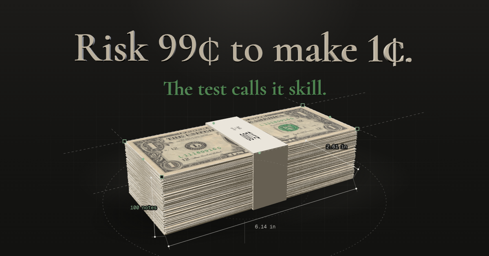

# Skill at 99¢

**Risk 99¢ to make 1¢. The test calls it skill.**

An interactive research site for my TKS Build. I rebuilt the sign-randomization skill test from Gómez-Cram, Guo, Jensen and Kung (2026) and ran it on 1,848,270 real Polymarket trades. My results came out reversed from the paper's, and this site shows why.

**Live site:** https://andrea-gervasoni.github.io/skill-at-99c/
**Article:** [[Medium link]](https://medium.com/@gervandre09/i-rebuilt-a-skill-test-on-1-8-million-polymarket-trades-it-called-a-7-cent-profit-skill-1e2cf6bf2562)
**Research code:** [GitHub link]



## What I found

| | Skilled (raw p) | Anti-skilled (raw p) |
|---|---|---|
| Paper, Table 1, 2023–2025 | 8.63% | 16.84% |
| My replication, Nov–Dec 2025 | 26.89% | 11.05% |

- **The price explains most of the gap.** Accounts that pay 99¢ or more for a contract worth $1 are flagged skilled 87.3% of the time (613 of 702), and none of them is flagged anti-skilled. Below 80¢, the test behaves close to the paper: 11.4% skilled, 14.1% anti-skilled.
- **A trader with no edge passes too.** A simulated 99¢ trader over 20 events is flagged skilled 82.7% of the time. The test flips the sign of each event's profit, so twenty wins of 1¢ become the best history the shuffles can produce, and the rare 99¢ loss never shows up.
- **This does not show the paper is wrong.** I applied the test as published, on a shorter window and a smaller sample. The problem appears where payoffs are this lopsided.

## Method

1. Built the test as a Python package and checked it on synthetic traders whose answer I knew in advance. The checks found three bugs, and the package ended with 87 tests.
2. Took the public Polymarket history from Hugging Face (`SII-WANGZJ/Polymarket_data`, commit `73bc1adc`): 1,266,885,846 fills in a 45.8 GB table.
3. Rebuilt every account's trades per event in DuckDB. NO trades were converted to YES terms, outcomes were read from final prices (45 ambiguous markets dropped), and market makers were removed with the paper's rule.
4. The full 2023–2025 run ran out of memory on a laptop twice, so the window is November–December 2025.
5. Tested 5,000 accounts drawn in a fixed order (4,850 with at least one buy), using B = 1,000 sign flips, seed 20261031 and a mid-p value.

**Limits:**
- The data covers two months, against three years in the paper.
- The standard error is about half a percentage point.
- 126 of the 150 accounts with no buys are also flagged skilled, and I have not traced why yet.

## The site

The site is a static one-page site in English and Italian (`?lang=it`), with no build step and no tracking.

- **3D:** three.js for the bundle of $1 notes, the coin and the extruded headline.
- **Motion:** GSAP ScrollTrigger and Lenis for scroll and charts that build as you arrive.
- **Data:** every number on the page is read from `data/site_data.json`. The scatter uses `data/accounts_novdec2025.json`.

To run it locally, ES modules need a server:

```bash
python3 -m http.server 8000
```

Then open http://localhost:8000.

## Credits

- **Paper:** Gómez-Cram, R., Guo, Y., Jensen, T. I., & Kung, H. (2026). *Prediction Market Accuracy: Crowd Wisdom or Informed Minority?* SSRN Working Paper.
- **Data:** SII-WANGZJ, *Polymarket_data*, Hugging Face.
- **$1 note:** scan of the obverse, public domain (work of the United States Government), via Wikimedia Commons. It is shown on one side only and at a size different from a real note, for education (31 CFR 411.1). It is not legal tender.
- **Fonts:** Cormorant Garamond and Geist Mono, SIL Open Font License.
- **Libraries:** three.js (MIT), Lenis (MIT), GSAP (standard license).

This is a student research project, not investment advice.

Andrea Gervasoni · TKS · November 2026
