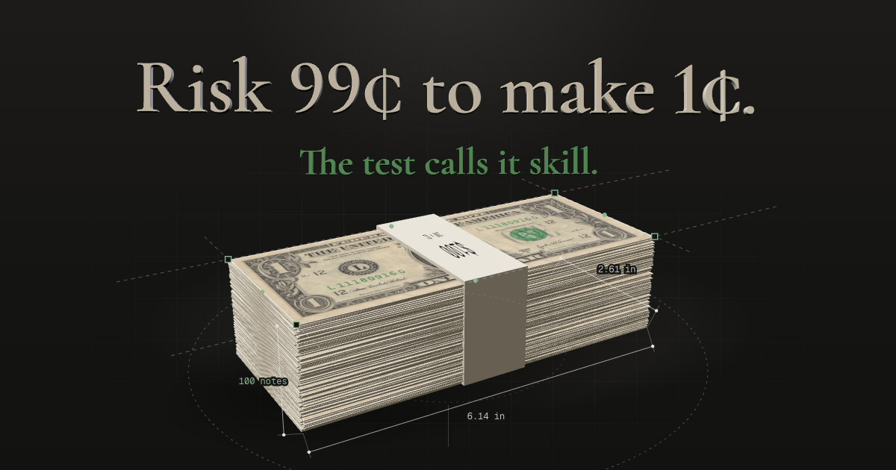

# Skill at 99¢

Risk 99¢ to make 1¢, and a well-known statistical test will call you skilled.

I'm a high-school student, and this started as a replication. A 2026 paper by Gómez-Cram, Guo, Jensen and Kung uses a sign-randomization test to separate skilled Polymarket traders from lucky ones. I rebuilt the test from scratch and ran it on 5,000 accounts, 1,848,270 trades in total. My numbers came out close to the opposite of the paper's, so I went looking for the reason. This repo is the website that shows what I found.

- **Live site:** https://andrea-gervasoni.github.io/skill-at-99c/
- **Article:** [on Medium](https://medium.com/@gervandre09/i-rebuilt-a-skill-test-on-1-8-million-polymarket-trades-it-called-a-7-cent-profit-skill-1e2cf6bf2562)
- **The research itself** (test, data pipeline, 87 tests): [polymarket-skill-test-replication](https://github.com/Andrea-Gervasoni/polymarket-skill-test-replication)



## What I found

| | Skilled (raw p) | Anti-skilled (raw p) |
|---|---|---|
| Paper, Table 1, 2023–2025 | 8.63% | 16.84% |
| My replication, Nov–Dec 2025 | 26.89% | 11.05% |

It comes down to price. When an account pays 99¢ or more for a contract that pays $1, the test calls it skilled 87.3% of the time (613 of 702 accounts), and none of them is flagged anti-skilled. Below 80¢ the test behaves about like the paper: 11.4% skilled, 14.1% anti-skilled.

To check that this isn't a quirk of the data, I simulated a trader with no edge who buys at 99¢ over 20 events. The test flags them as skilled 82.7% of the time. My explanation: the test flips the sign of each event's profit at random, and a history of twenty 1¢ wins is very hard to beat by shuffling. The rare 99¢ loss, the one that would show this trader is only selling insurance, usually doesn't appear in 20 events.

None of this proves the paper is wrong. I used a shorter window and a smaller sample, and I applied the test exactly as published. What I can say is that the test seems to struggle when the payoffs are this lopsided.

## How I did it

1. I wrote the test as a Python package and checked it on synthetic traders whose answer I knew in advance. That found three bugs. The package ended up with 87 tests.
2. The data is the public Polymarket history on Hugging Face (`SII-WANGZJ/Polymarket_data`, commit `73bc1adc`): 1,266,885,846 fills, a 45.8 GB table.
3. With DuckDB I rebuilt every account's trades per event. NO trades are converted to YES terms, outcomes are read from final prices (45 ambiguous markets dropped), and market makers are removed with the paper's rule.
4. The full 2023–2025 run crashed my laptop twice for lack of memory, so I narrowed the window to November–December 2025. That leaves 82,568 eligible accounts.
5. From those I drew 5,000 accounts in a fixed order (4,850 with at least one buy) and tested each with 1,000 sign flips, seed 20261031 and a mid-p value. Their trades are the 1,848,270 above.

## What I haven't solved

- Two months of data, against three years in the paper.
- The standard error is about half a percentage point.
- 126 of the 150 accounts with no buys at all are also flagged skilled. I haven't traced why yet.

## The site

It's a static one-page site in English and Italian (add `?lang=it`), with no build step and no tracking. The 3D bundle of $1 notes, the coin and the headline use three.js. Scrolling and the charts use GSAP ScrollTrigger and Lenis. Every number on the page is read from `data/site_data.json`, and the scatter plot uses `data/accounts_novdec2025.json`.

To run it locally you need a server, because it uses ES modules:

```bash
python3 -m http.server 8000
```

Then open http://localhost:8000.

## Credits

- **Paper:** Gómez-Cram, R., Guo, Y., Jensen, T. I., & Kung, H. (2026). *Prediction Market Accuracy: Crowd Wisdom or Informed Minority?* SSRN Working Paper.
- **Data:** SII-WANGZJ, *Polymarket_data*, Hugging Face.
- **$1 note:** scan of the obverse, public domain (work of the United States Government), via Wikimedia Commons. It is shown on one side only and at a size different from a real note, for education (31 CFR 411.1). It is not legal tender.
- **Coin:** a coin of Trajan, photo by Classical Numismatic Group, Inc., [CC BY-SA 2.5](https://creativecommons.org/licenses/by-sa/2.5/), via [Wikimedia Commons](https://commons.wikimedia.org/wiki/File:Traianus_denarius_105_90020184.jpg). I cropped it and turned it to greyscale for the 3D coins. The edited textures (`assets/coin-*.webp`) keep the same licence.
- **Fonts:** Newsreader and Geist Mono, SIL Open Font License.
- **Libraries:** three.js (MIT), Lenis (MIT), GSAP (standard license).

## License

The code is MIT, see [LICENSE](LICENSE). The coin textures stay under CC BY-SA 2.5, as noted above.

This is a student research project, not investment advice.

Andrea Gervasoni · TKS · November 2026
